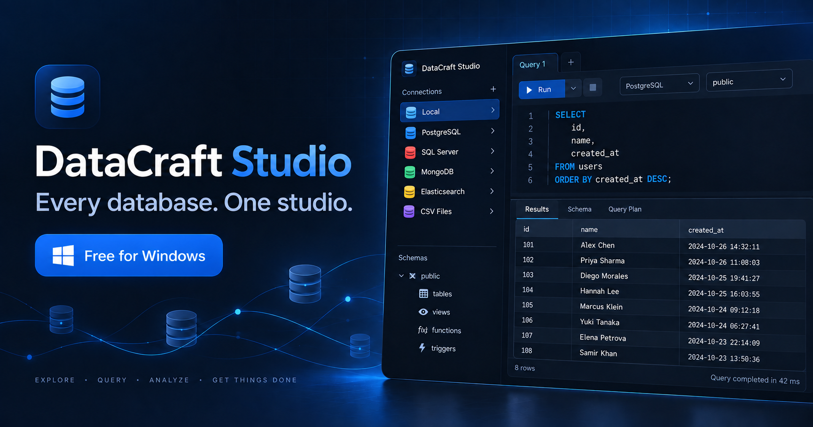
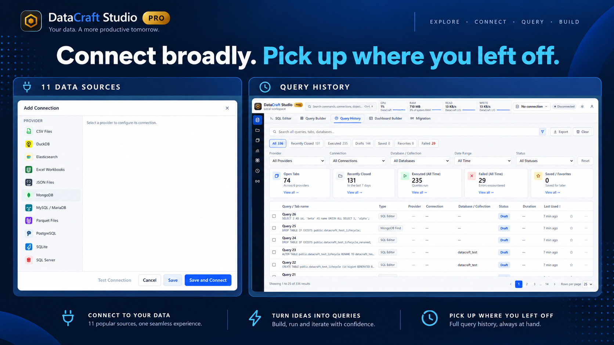
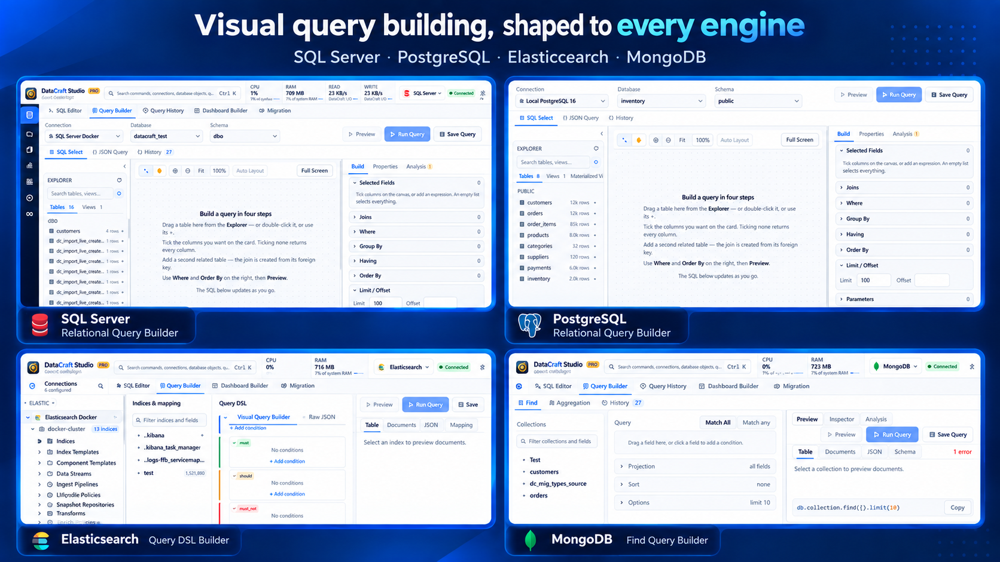
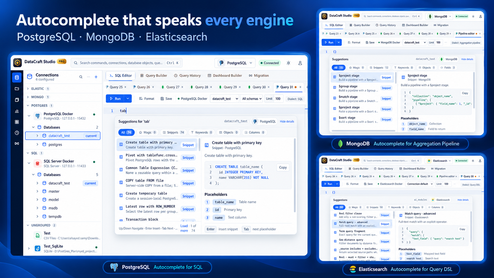
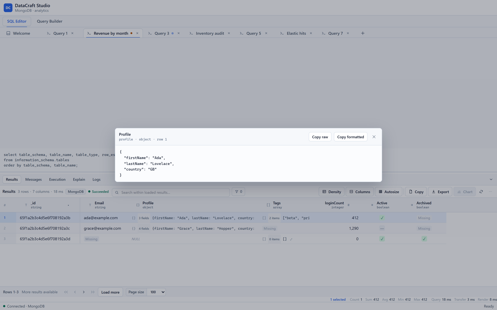
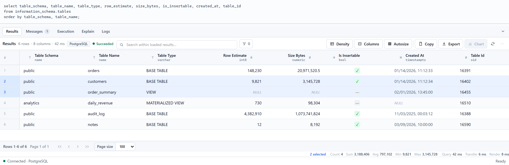
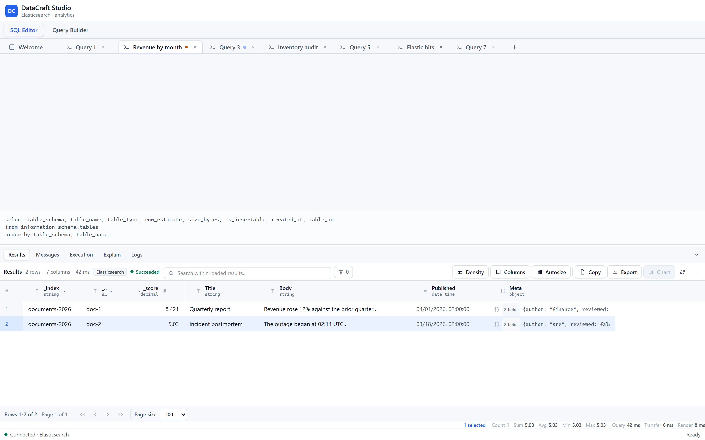
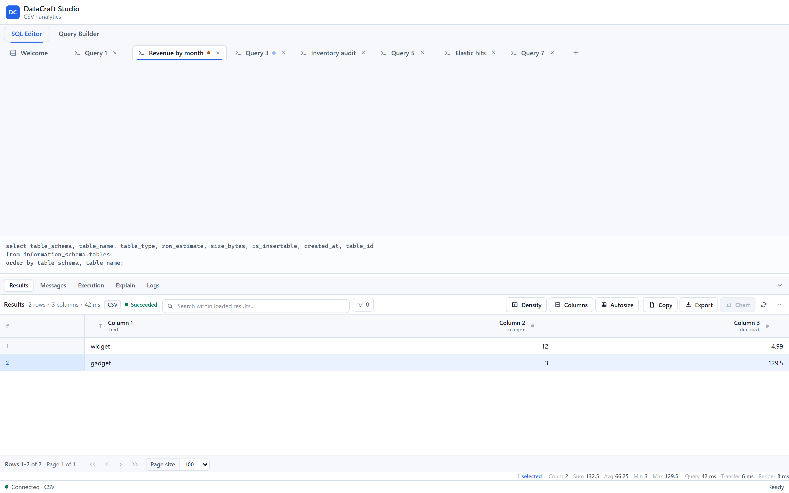
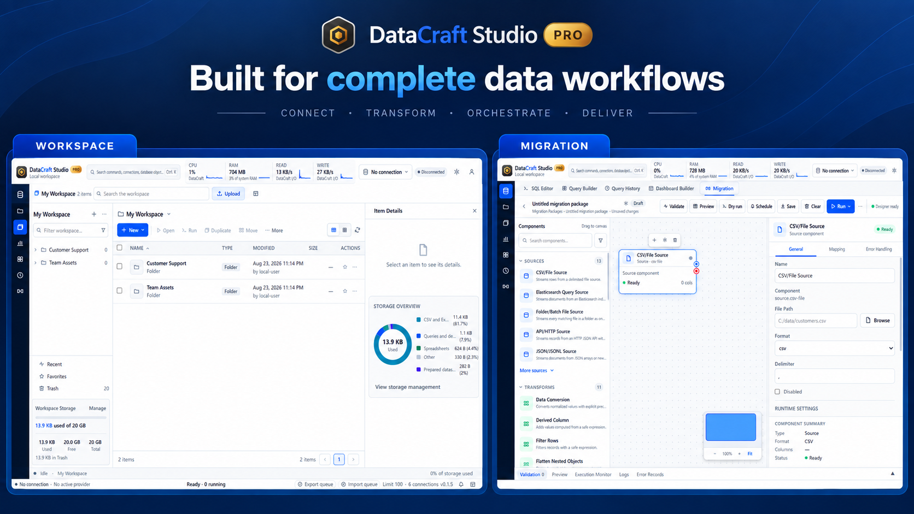

<div align="center">


# DataCraft Studio

### One workspace for every data source you use.

Explore, query and understand relational databases, document stores, search engines,<br>
spreadsheets and local files—without switching tools or sending your data anywhere.

[](https://github.com/elsayedsamyeid/datacraft-studio/releases/latest/download/DataCraft-Studio-x64-setup.exe)
&nbsp;
[](https://github.com/elsayedsamyeid/datacraft-studio/releases/latest)
&nbsp;
[](#download)

**Free forever** · **No account** · **No telemetry** · **11 data sources**

<br>



</div>

<br>

> [!NOTE]
> **Official release repository.** Installers, documentation and issue tracking live here; proprietary source code does not. Every release includes SHA-256 checksums.

## One workflow, built properly

DataCraft is designed around the work—not around one database driver.

- **Connect broadly.** Eleven source types use one consistent connection flow.
- **Stay in context.** The same explorer, editor, result grid, shortcuts and export follow you across providers.
- **Get useful completion.** Suggestions come from live schema metadata, including native types, aliases, fields and functions.
- **Keep your data private.** No account, no telemetry, and credentials stay in Windows Credential Manager.
- **Run native.** A Rust core and native window deliver desktop startup without a Java runtime.
- **See only what works.** Provider capabilities shape the interface, so unsupported actions do not become dead buttons.

## Supported data sources

| Source | Kind | Source | Kind |
| --- | --- | --- | --- |
| **PostgreSQL** | Relational | **SQL Server** | Relational |
| **MySQL / MariaDB** | Relational | **SQLite** | Embedded relational |
| **DuckDB** | Analytical | **MongoDB** | Document |
| **Elasticsearch** | Search | **CSV Files** | Delimited files |
| **Excel Workbooks** | Spreadsheet | **JSON Files** | Document files |
| **Parquet Files** | Columnar files |  |  |



One connection flow covers all eleven source types. Query History then lets you search across providers, connections, databases, drafts, executions and failures.

## Visual query building, shaped to every engine

Pro gives each engine a builder designed around its native model: a relational canvas for SQL Server, a visual Query DSL workflow for Elasticsearch, and document-first Find and Aggregation builders for MongoDB.



Build visually, inspect the generated query, preview the result, then save or run it—all without forcing unlike engines into the same interface.

## A closer look

### Autocomplete that understands your engine

Autocomplete follows the active connection and dialect—not a generic word list. In SQL Server, DataCraft groups snippets, objects, columns and keywords, previews the selected snippet, and guides you through placeholders without leaving the keyboard.



The same completion workflow adapts across engines: PostgreSQL SQL snippets, MongoDB aggregation stages, Elasticsearch Query DSL, and SQL Server T-SQL—each with provider-specific previews and placeholders.

### One grid for every shape of data

Rows, documents, search hits and CSV lines all land in the same grid:

- **Typed column headers**, straight from the engine
- **Selection aggregates**: count, sum, average, min and max as you select
- **Search within loaded results** without running the query again
- **Nested objects and arrays** shown inline, and opened in a JSON viewer with one click
- **Export** to CSV, JSON or the clipboard

<picture>
  <source media="(prefers-color-scheme: dark)" srcset="assets/screenshots/json-viewer-dark.png">
  
</picture>

<details>
<summary><b>More screenshots</b>: PostgreSQL, Elasticsearch, CSV</summary>
<br>

**PostgreSQL results**

<picture>
  <source media="(prefers-color-scheme: dark)" srcset="assets/screenshots/hero-results-dark.png">
  
</picture>

**Elasticsearch hits**

<picture>
  <source media="(prefers-color-scheme: dark)" srcset="assets/screenshots/results-elasticsearch-dark.png">
  
</picture>

**A folder of CSV files, queried like a database**

<picture>
  <source media="(prefers-color-scheme: dark)" srcset="assets/screenshots/results-csv-dark.png">
  
</picture>

</details>

## Download

### [Download DataCraft Studio Free for Windows →](https://github.com/elsayedsamyeid/datacraft-studio/releases/latest/download/DataCraft-Studio-x64-setup.exe)

**One download. One installer. Nothing else required.**

The setup includes the app-local Visual C++ runtime files and the Microsoft WebView2 bootstrapper. Users do not need to find or install the DLLs separately.

**Requirements:** Windows 10 or 11, 64-bit.

**Verify your download:** every release includes `SHA256SUMS.txt`. In PowerShell:

```powershell
Get-FileHash .\DataCraft-Studio-x64-setup.exe -Algorithm SHA256
```

> Windows SmartScreen may warn about a new publisher on first run. Choose **More info → Run anyway** after you've checked the hash.

## Free and Pro

Start with a complete free database workspace. Move to Pro when you need visual building, durable workspaces and end-to-end data workflows. Installing Pro over Free keeps your settings.



The free edition isn't a trial and has no time limit.

| | Free | Pro *(coming)* |
| --- | :---: | :---: |
| All eleven data sources, unlimited connections | ✅ | ✅ |
| Metadata explorer | ✅ | ✅ |
| Query editor with engine-aware autocomplete | ✅ | ✅ |
| Result grid, JSON viewer, aggregates, export | ✅ | ✅ |
| Light and dark themes, system meters | ✅ | ✅ |
| Visual query builders for SQL and MongoDB | | ✅ |
| Query history and saved workspace | | ✅ |
| Guided data import wizard | | ✅ |
| Data migration between engines | | ✅ |
| Dashboards and provider health | | ✅ |
| AI assistant with your choice of model provider | | ✅ |

Pro will unlock with an **offline licence key** pasted into Settings. There's still no account and no login, and it works on air-gapped machines. Installing Pro over Free upgrades in place and keeps your settings.

## FAQ

<details>
<summary><b>Is the free edition really free?</b></summary>
<br>
Yes. It has no time limit, no connection limit and no account. All supported data sources are included, because a free build that locks out your data isn't much use.
</details>

<details>
<summary><b>Does DataCraft collect data about me?</b></summary>
<br>
No. There is no telemetry and nothing to sign into. The free edition only connects to the data sources you add.
</details>

<details>
<summary><b>Where are my database passwords stored?</b></summary>
<br>
In Windows Credential Manager. They are never written to connection profiles or log files.
</details>

<details>
<summary><b>What about macOS and Linux?</b></summary>
<br>
Only Windows is published today. Watch this repository (<b>Watch → Custom → Releases</b>) to hear when other platforms ship.
</details>

<details>
<summary><b>Is it open source?</b></summary>
<br>
No. DataCraft Studio is free to use but closed source. This repository publishes releases, documentation and the issue tracker. See <a href="LICENSE.md">LICENSE.md</a>.
</details>

## Feedback and support

- 🐛 **Found a bug?** [Open an issue](https://github.com/elsayedsamyeid/datacraft-studio/issues/new?template=bug_report.yml)
- 💡 **Missing something?** [Request a feature](https://github.com/elsayedsamyeid/datacraft-studio/issues/new?template=feature_request.yml)
- 🔐 **Security issue?** Please report it privately. See [SECURITY.md](SECURITY.md)
- ⭐ **Like it?** Star the repository. It helps other developers find it.

---

<sub>© 2026 Sayed Masry. DataCraft Studio is free to use under the terms in <a href="LICENSE.md">LICENSE.md</a>. PostgreSQL, SQL Server, MongoDB and Elasticsearch are trademarks of their respective owners; they are named only to identify the databases DataCraft connects to, and no affiliation or endorsement is implied.</sub>
