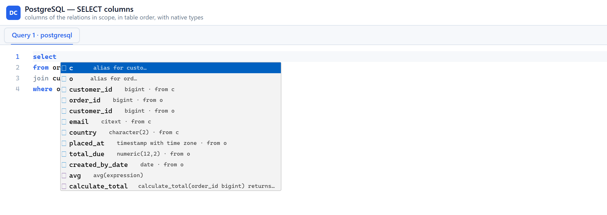

<div align="center">


# DataCraft Studio

### One workspace for every data source you use.

Explore, query and understand relational databases, document stores, search engines,<br>
spreadsheets and local files—without switching tools or sending your data anywhere.

[](https://github.com/elsayedsamyeid/datacraft-studio/releases/latest/download/DataCraft-Studio-x64-setup.exe)
&nbsp;
[](https://github.com/elsayedsamyeid/datacraft-studio/releases/latest)
&nbsp;
[](#download)

**Free forever** · **No account** · **No telemetry** · **11 data sources**

<br>


<br>

> **Official release repository.** Installers, documentation and issue tracking live here; the proprietary source code does not. Every download includes a SHA-256 checksum.

</div>

<br>

## Why developers choose DataCraft

<table>
<tr>
<td width="33%" valign="top">

### 🗄️ Eleven sources, one tool
Databases, document stores, search, spreadsheets and local files share the same explorer, grid, shortcuts and export. Provider coverage is **built in**, not bolted on.

</td>
<td width="33%" valign="top">

### ⚡ Native, not a JVM
A Rust core in a native window. It starts like a desktop app, stays light on memory, and needs no Java runtime.

</td>
<td width="33%" valign="top">

### 🔒 Your data stays yours
No sign-up, no login, no usage tracking. Passwords live in **Windows Credential Manager**, never in a profile file.

</td>
</tr>
<tr>
<td width="33%" valign="top">

### 🧠 Autocomplete that knows your engine
Suggestions come from the live schema: columns with their native types, alias scope, functions with signatures, MongoDB fields and operators.

</td>
<td width="33%" valign="top">

### 🧩 No dead buttons
Each engine declares what it can do, and the interface is built from that. If an engine can't do something, you won't see a button for it.

</td>
<td width="33%" valign="top">

### 📦 Nothing else to install
Installers carry the Visual C++ runtime and the WebView2 bootstrapper. Download, install, connect.

</td>
</tr>
</table>

## Supported data sources

| Source | Kind | Source | Kind |
| --- | --- | --- | --- |
| **PostgreSQL** | Relational | **SQL Server** | Relational |
| **MySQL / MariaDB** | Relational | **SQLite** | Embedded relational |
| **DuckDB** | Analytical | **MongoDB** | Document |
| **Elasticsearch** | Search | **CSV Files** | Delimited files |
| **Excel Workbooks** | Spreadsheet | **JSON Files** | Document files |
| **Parquet Files** | Columnar files |  |  |


One connection flow covers all eleven source types. Query History then lets you search across providers, connections, databases, drafts, executions and failures.

## A closer look

### Autocomplete with the schema behind it

Type `o.` and you get that table's columns with their real types. Completion follows the tables in scope, knows which alias belongs to which table, and adapts to each engine's dialect.

<picture>
  <source media="(prefers-color-scheme: dark)" srcset="assets/screenshots/completion-dark.png">
  
</picture>

### One grid for every shape of data

Rows, documents, search hits and CSV lines all land in the same grid:

- **Typed column headers**, straight from the engine
- **Selection aggregates**: count, sum, average, min and max as you select
- **Search within loaded results** without running the query again
- **Nested objects and arrays** shown inline, and opened in a JSON viewer with one click
- **Export** to CSV, JSON or the clipboard

<picture>
  <source media="(prefers-color-scheme: dark)" srcset="assets/screenshots/json-viewer-dark.png">
  
</picture>

<details>
<summary><b>More screenshots</b>: PostgreSQL, Elasticsearch, CSV</summary>
<br>

**PostgreSQL results**

<picture>
  <source media="(prefers-color-scheme: dark)" srcset="assets/screenshots/hero-results-dark.png">
  
</picture>

**Elasticsearch hits**

<picture>
  <source media="(prefers-color-scheme: dark)" srcset="assets/screenshots/results-elasticsearch-dark.png">
  
</picture>

**A folder of CSV files, queried like a database**

<picture>
  <source media="(prefers-color-scheme: dark)" srcset="assets/screenshots/results-csv-dark.png">
  
</picture>

</details>

## Download

| File | Best for |
| --- | --- |
| [**DataCraft-Studio-x64-setup.exe**](https://github.com/elsayedsamyeid/datacraft-studio/releases/latest/download/DataCraft-Studio-x64-setup.exe) | Most people. A standard Windows installer |
| [**DataCraft-Studio-x64.msi**](https://github.com/elsayedsamyeid/datacraft-studio/releases/latest/download/DataCraft-Studio-x64.msi) | IT-managed machines and silent deployment |
| [**DataCraft-Studio-x64-portable.zip**](https://github.com/elsayedsamyeid/datacraft-studio/releases/latest/download/DataCraft-Studio-x64-portable.zip) | No install. Extract the **whole folder** and run the `.exe` |

**Requirements:** Windows 10 or 11, 64-bit. The portable build also needs the Microsoft WebView2 runtime, which Windows 11 and up-to-date Windows 10 already have. The installers add it automatically if it's missing.

**Verify your download:** every release includes `SHA256SUMS.txt`. In PowerShell:

```powershell
Get-FileHash .\DataCraft-Studio-x64-setup.exe -Algorithm SHA256
```

> Windows SmartScreen may warn about a new publisher on first run. Choose **More info → Run anyway** after you've checked the hash.

## Free and Pro

Start with a complete free database workspace. Move to Pro when you need visual building, durable workspaces and end-to-end data workflows. Installing Pro over Free keeps your settings.


The free edition isn't a trial and has no time limit.

| | Free | Pro *(coming)* |
| --- | :---: | :---: |
| All eleven data sources, unlimited connections | ✅ | ✅ |
| Metadata explorer | ✅ | ✅ |
| Query editor with engine-aware autocomplete | ✅ | ✅ |
| Result grid, JSON viewer, aggregates, export | ✅ | ✅ |
| Light and dark themes, system meters | ✅ | ✅ |
| Visual query builders for SQL and MongoDB | | ✅ |
| Query history and saved workspace | | ✅ |
| Guided data import wizard | | ✅ |
| Data migration between engines | | ✅ |
| Dashboards and provider health | | ✅ |
| AI assistant with your choice of model provider | | ✅ |

Pro will unlock with an **offline licence key** pasted into Settings. There's still no account and no login, and it works on air-gapped machines. Installing Pro over Free upgrades in place and keeps your settings.

## FAQ

<details>
<summary><b>Is the free edition really free?</b></summary>
<br>
Yes. It has no time limit, no connection limit and no account. All supported data sources are included, because a free build that locks out your data isn't much use.
</details>

<details>
<summary><b>Does DataCraft collect data about me?</b></summary>
<br>
No. There is no telemetry and nothing to sign into. The free edition only connects to the data sources you add.
</details>

<details>
<summary><b>Where are my database passwords stored?</b></summary>
<br>
In Windows Credential Manager. They are never written to connection profiles or log files.
</details>

<details>
<summary><b>What about macOS and Linux?</b></summary>
<br>
Only Windows is published today. Watch this repository (<b>Watch → Custom → Releases</b>) to hear when other platforms ship.
</details>

<details>
<summary><b>Is it open source?</b></summary>
<br>
No. DataCraft Studio is free to use but closed source. This repository publishes releases, documentation and the issue tracker. See <a href="LICENSE.md">LICENSE.md</a>.
</details>

## Feedback and support

- 🐛 **Found a bug?** [Open an issue](https://github.com/elsayedsamyeid/datacraft-studio/issues/new?template=bug_report.yml)
- 💡 **Missing something?** [Request a feature](https://github.com/elsayedsamyeid/datacraft-studio/issues/new?template=feature_request.yml)
- 🔐 **Security issue?** Please report it privately. See [SECURITY.md](SECURITY.md)
- ⭐ **Like it?** Star the repository. It helps other developers find it.

---

<sub>© 2026 Sayed Masry. DataCraft Studio is free to use under the terms in <a href="LICENSE.md">LICENSE.md</a>. PostgreSQL, SQL Server, MongoDB and Elasticsearch are trademarks of their respective owners; they are named only to identify the databases DataCraft connects to, and no affiliation or endorsement is implied.</sub>
